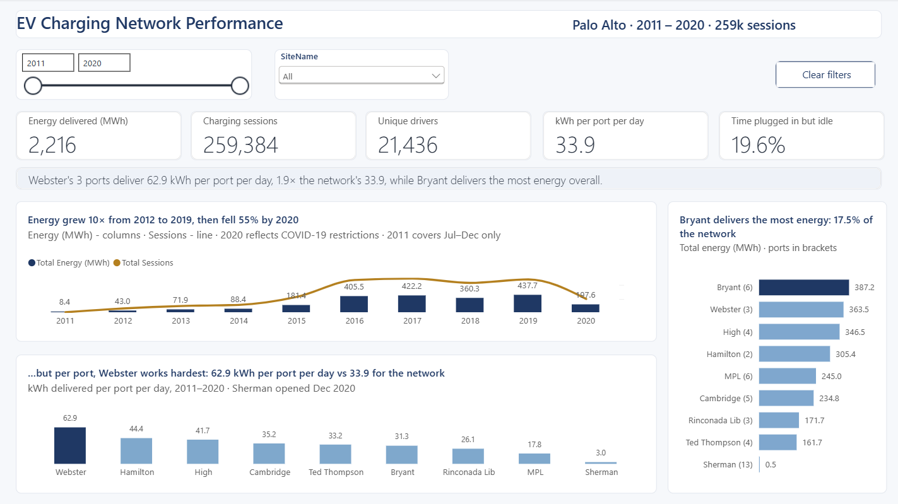

# EV Charging Network Performance

**A seven-page Power BI report on nine years of public charging data from Palo Alto, asking one question: which sites actually earn their hardware?**

Real public data · no client · every step from raw CSV to validated finding shown in full.

[Case study](https://www.jolaandco.com/ev-charging) · [3-minute walkthrough](https://youtu.be/o9-g2lTQmJI) · [jolaandco.com](https://www.jolaandco.com)

---

## At a glance

| | |
|---|---|
| **Data** | City of Palo Alto EV charging sessions, 29 Jul 2011 – 31 Dec 2020 |
| **Volume** | 259,415 raw rows → **259,384 sessions** analysed · 46 ports · 9 sites · 2,216 MWh |
| **Model** | Star schema: one fact table, five dimensions, single-direction 1:* relationships |
| **Report** | 7 pages, including a drill-through for any site, benchmarked against the network |
| **Tools** | Power BI Desktop · Power Query (M) · DAX · Azure Maps |
| **Format** | Saved as a Power BI Project (`.pbip`), so the model and every measure are readable text |

---

## What the data says

**1. Bigger sites aren't busier.** Webster's 3 ports deliver **62.9 kWh per port per day**, 1.9× the network's 33.9. The largest sites sit below the network line. Bryant delivers the most energy overall (387.2 MWh, 17.5%), but needs six ports to do it.

**2. A weak site can hide working ports.** MPL ranks near the bottom (17.8 kWh per port per day), but its weakness sits in individual ports, not the site. The Site Detail page shows a few ports delivering a fraction of the network rate while the rest are close to average. The fix there is maintenance or bay placement, not more hardware.

**3. Pricing had a cost and a payoff.** Fees began on **1 August 2017** at every site except Sherman. Comparing 2015–16 with 2018–19, sessions per port fell **26%**, while average idle time per session fell from **44 to 18 minutes** (2016 vs 2019). The report says *coincided with*: the data shows timing, not cause.

**Also:** demand peaks 11:00–13:00 on weekdays with a second peak at 18:00. Weekends run at about 78% of weekday volume per day. The top 1% of users generate 31% of sessions.

Every finding, its evidence and its status is in the [findings register](docs/05-findings-register.md).

---

## The first answer was wrong

The most useful part of this project is the record of what changed.

- **Ports aren't live before they exist.** The first utilisation measure treated every port as available from 2011, so sites that opened later looked idle. Counting each port from its first session fixed it, and the top site changed from Hamilton to Webster.
- **The starting hypothesis didn't hold.** The plan assumed fees hadn't reduced usage. Per port, they had, and the report states what the data supports.
- **Blanks are not a user.** Missing user IDs were stored as empty text, which turned 7,677 anonymous sessions into one very active "driver". Converting them to null removed them from every user measure.

The full list is in the [validation log](docs/04-validation-log.md).

---

## Report pages

| # | Page | Question it answers |
|---|---|---|
| 1 | [Executive Overview](screenshots/01-executive-overview.png) | How big is the network, is it growing, and who works hardest per port? |
| 2 | [Demand Patterns](screenshots/02-demand-patterns.png) | When is it busy, and when does charging turn into parking? |
| 3 | [Site & Station Performance](screenshots/03-site-station-performance.png) | Which sites earn their hardware? |
| 4 | [Site Detail](screenshots/04-site-detail-drillthrough.png) (drill-through) | How does one site, and each of its ports, compare with the network? |
| 5 | [Users & Revenue](screenshots/05-users-revenue.png) | Who uses the network, and what changed when charging stopped being free? |
| 6 | [Data & Model](screenshots/06-data-model.png) | Where the data came from and how it was reconciled |
| 7 | [Assumptions & Validation](screenshots/07-assumptions-validation.png) | Every assumption, definition and correction, written down |

## Built to survive a filter

- **Headlines and chart titles are DAX measures.** They recalculate with every slicer, so a title can't contradict the chart under it.
- **Claims are guarded.** "Strongest case for expansion" only appears when every port at the top site is busy, and sites with fewer than 500 sessions are flagged, not ranked.
- **Every site is judged against the whole.** Network benchmark measures remove the site filter but keep the date filter.
- **Relative formatting.** Heat-map colours and font rules use percentiles of what's on screen, so they hold at any filter.

---

## Data model

`Fact_Sessions` holds keys, numbers and quality flags only. Dimensions: `Dim_Date`, `Dim_Time`, `Dim_Station` (one row per port), `Dim_User` and `Dim_EndReason`. Details in [docs/02-data-model.md](docs/02-data-model.md).

---

## Repository contents

| Path | What it is |
|---|---|
| [`report/`](report) | The Power BI Project (`.pbip`): report layout and semantic model as text |
| [`docs/01-report-blueprint.md`](docs/01-report-blueprint.md) | The argument, page-by-page design and consistency rules |
| [`docs/02-data-model.md`](docs/02-data-model.md) | Power Query architecture, cleaning steps, star schema |
| [`docs/03-measures.md`](docs/03-measures.md) | The measures that carry the analysis, with the reasoning behind them |
| [`docs/04-validation-log.md`](docs/04-validation-log.md) | Checks performed and corrections made |
| [`docs/05-findings-register.md`](docs/05-findings-register.md) | Every finding, its evidence and status |
| [`docs/06-assumptions-definitions.md`](docs/06-assumptions-definitions.md) | Assumptions, limitations and metric definitions |
| [`screenshots/`](screenshots) | One image per report page |
| [`diagrams/`](diagrams) | Star schema |
| [`theme/`](theme) | Power BI theme JSON used across the report |
| [`data/`](data) | Where to get the dataset; see [`data/README.md`](data/README.md) |

## Running it yourself

1. Download the dataset (see [`data/README.md`](data/README.md)).
2. Open `report/EV_Charging_Report.pbip` in Power BI Desktop.
3. In Power Query, set the `p_DataFolder` parameter to the folder holding the CSV, then refresh.

---

**Jolanta Tacij** · Business & BI Analyst · EV infrastructure
[jolaandco.com](https://www.jolaandco.com) · [LinkedIn](https://www.linkedin.com/in/jola-tacij)

Analysis, report and documentation © Jolanta Tacij. Underlying data: City of Palo Alto EV charging station usage, via Kaggle.
