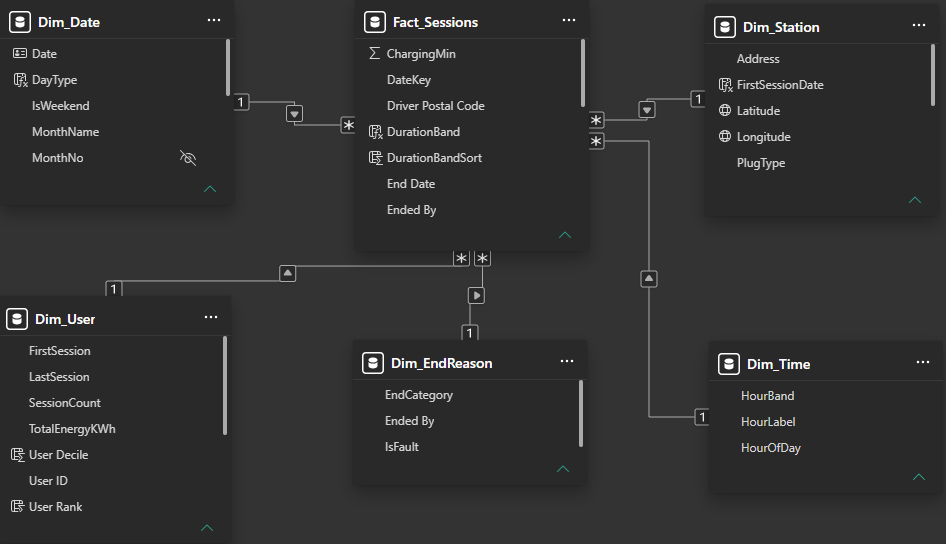

# Data model and Power Query

## Source

One CSV: `EVChargingStationUsage.csv`, 259,415 rows, 33 columns, one row per charging session. See [`../data/README.md`](../data/README.md) for where to get it.

## Query architecture

Queries are grouped so the dependency chain reads top to bottom:

| Group | Holds | Loads to model? |
|---|---|---|
| `00_Params` | `p_DataFolder`, the folder holding the CSV | No |
| `01_Staging` | `Src_Sessions` (typed, unshaped source) and `QA_Rejected` | No |
| `02_Dim` | `Dim_Date`, `Dim_Time`, `Dim_Station`, `Dim_User`, `Dim_EndReason` | Yes |
| `03_Fact` | `Fact_Sessions` | Yes |

Every dimension and the fact table **reference** the staging query rather than duplicating it, so a cleaning rule is written once. The file path lives in one parameter, so moving the project means changing one value.

## Cleaning, in order

1. **Drop unused columns** (MAC address, org name, EVSE ID, gasoline savings, serial and model numbers, and so on) before typing anything.
2. **Explicit types with the `en-US` locale**, so `7/29/2011` never depends on the machine's regional settings. IDs and postal codes are text. Durations over 24 hours stay text until converted, because `type time` can't hold `114:32:26`.
3. **Mixed-format end dates repaired.** 80 rows held Excel serial numbers rather than text dates; they are converted from the 1899-12-30 epoch.
4. **Durations converted to minutes.** `TotalMin`, `ChargingMin` and `IdleMin = TotalMin − ChargingMin`.
5. **Keys derived.** `DateKey` (session start date), `HourOfDay` (start hour), `SiteName` (station name before the `#`).
6. **Duplicates removed** on the natural key (plug-in event ID + station + start time): 17 rows.
7. **Scope filter.** USD sessions only: 14 non-USD rows excluded.
8. **Quality flags, not deletions.** Sessions where charging time exceeds plugged-in time, and sessions over 24 hours, are kept and flagged.
9. **Missing user IDs set to null.** They arrived as empty text, which counted as a single user; see the [validation log](04-validation-log.md).

`QA_Rejected` holds the excluded and repaired rows, so every number on the reconciliation table can be traced:

| Step | Sessions |
|---|---|
| Raw file | 259,415 |
| − Duplicate records | −17 |
| − Non-USD sessions | −14 |
| **Analysed** | **259,384** |

## Star schema

| Table | Grain | Notes |
|---|---|---|
| `Fact_Sessions` | One row per session | Keys, minutes, energy, fee and quality flags only |
| `Dim_Date` | One row per day, whole years 2011–2020 | Built in Power Query, marked as the date table, sort-by columns for month and weekday |
| `Dim_Time` | One row per hour (24) | `HourBand` (Night / Morning / Midday / Evening) with a numeric sort column |
| `Dim_Station` | **One row per port** (46 rows) | `SiteName` groups ports into 9 sites; `FirstSessionDate` drives the port-days denominator; coordinates taken as one value per station so each has one map pin |
| `Dim_User` | One row per user ID | Lifetime session count, `UserBand`, rank and decile for the Pareto view |
| `Dim_EndReason` | One row per "Ended by" value | Grouped into Normal vs Fault for the fault rate |

All relationships are one-to-many, single direction. No bi-directional filters.

### Two modelling rules worth stating

- **`PortCount` is a site-level attribute repeated on every port row.** It is never summed: summing it would square the count. Port counts use `COUNTROWS(Dim_Station)`.
- **User bands and deciles are calculated columns.** They are computed once at refresh from lifetime counts and do not respond to slicers. Pages that use them say so in their subtitles.
